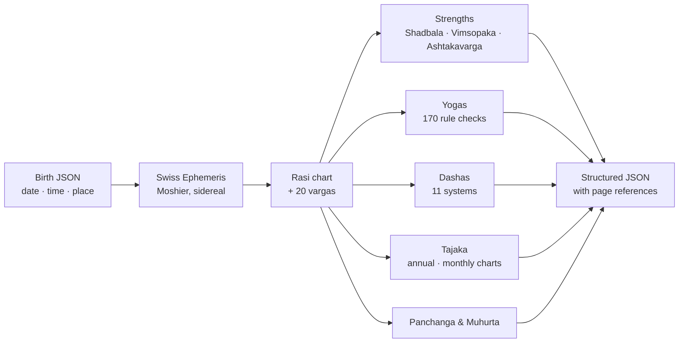

<div align="center">

# 🪐 Vedic Astrology Toolkit

**An open-source, test-verified Jyotish calculation engine in Python, built chapter by chapter from P. V. R. Narasimha Rao's *Vedic Astrology: An Integrated Approach*.**

[](https://github.com/chethandvg/vedic-astrology-toolkit/actions/workflows/tests.yml)


[](LICENSE.txt)
[](https://chethandvg.github.io/vedic-astrology-toolkit/)

Birth charts · 20 divisional charts · Shadbala · Ashtakavarga · 170 yogas · 11 dasha systems · Tajaka annual charts · Panchanga · Muhurta screening

### 🌐 [Open the web app: Jyotish Daily →](https://chethandvg.github.io/vedic-astrology-toolkit/)

Your chart, dashas and daily, weekly, monthly and yearly guidance, computed privately on your device.

</div>

---

## ✨ Why this project

- **Calculation-first and auditable.** Rules carry page references to the book they implement (1-based PDF page numbers). When classical texts disagree, the toolkit names the choice instead of hiding it.
- **Checked against independent references.** Planet positions match NASA/JPL DE440s within 1.2″ for the Moon and 0.3″ for other bodies (67/67 comparisons). Ashtakavarga, dasha, divisional-chart and Tajaka results reproduce the book's worked examples.
- **Honest about limits.** Disagreements with other software, rules that cannot be satisfied under the chosen conventions and experimental features are all labelled. Nothing is presented as a validated prediction.
- **Scriptable.** One JSON file in, structured JSON out. Easy to plug into notebooks, research pipelines or a web app.

## 📱 Jyotish Daily web app

**[https://chethandvg.github.io/vedic-astrology-toolkit/](https://chethandvg.github.io/vedic-astrology-toolkit/)** · free, no sign-up, works offline once loaded

A fast, mobile-friendly companion to the toolkit. It runs the **same Swiss Ephemeris code compiled to WebAssembly**, and parity tests check it against the Python toolkit on 64 reference charts (planet positions agree to within 0.00000001°). Your birth details never leave your browser.

- **Today:** a favourable / mixed / challenging rating with plain-English reasons, Rahu Kalam, Yamaganda, Gulika Kalam, Abhijit, Durmuhurta, Choghadiya and horas for where you are, Tara bala, Chandra bala and Chandrashtama
- **Week, Month, Year:** best and go-gently days, a calendar coloured by rating, Jupiter/Saturn/Rahu–Ketu transits with dates, Sade Sati, Muntha and dasha changes
- **Chart:** North and South Indian charts, 20 divisional charts, planet table, panchanga, the Vimsottari timeline (solar-year or Rao's 360-day years), **170 yogas** with plain-English meanings and the planets that form them, and **Shadbala / Vimsopaka** strength with functional benefics and malefics for the lagna
- **Readings that know your chart:** dasha and transit reasons weigh the dasha lord's houses, strength and yogas in *your* chart, not just your Moon sign
- **Varshaphal:** the Tajaka annual chart for each year: Muntha, year lord, sahams and Mudda dasha
- **Kundli matching:** 36-guna Ashtakoota, South Indian 10 porutham and Manglik (Kuja dosha) with cancellations
- **Printable report:** a clean A4 kundli report you can save as PDF
- **Your language:** English, ಕನ್ನಡ, हिन्दी, தமிழ், తెలుగు (AI-assisted translations, corrections welcome)

| Today on desktop | Today on a phone | A month, light theme |
|---|---|---|
|  |  |  |

Source and developer notes: [web/README.md](web/README.md).

## 🚀 Quick start

Requires Python 3.10 or newer.

```bash
git clone https://github.com/chethandvg/vedic-astrology-toolkit.git
cd vedic-astrology-toolkit
python -m venv .venv
source .venv/bin/activate          # Windows PowerShell: .venv\Scripts\Activate.ps1
python -m pip install -r requirements.txt
python -m unittest discover -s tests -t .   # runs all 225 tests
```

Cast a chart for the book's Example 118 (8 March 1967, 5:40 pm IST, 26°N18′, 73°E04′):

```bash
python -m vedic_toolkit chart examples/book_example_118.json --output chart.json
```

<details>
<summary><b>Sample output (Lahiri ayanamsa, mean nodes, rounded to the arc-minute)</b></summary>

| Body | Sign | Position | Nakshatra (pada) |
|---|---|---|---|
| Lagna | Leo | 10°47′ | Makha (4) |
| Sun | Aquarius | 23°50′ | Poorvaabhaadra (2) |
| Moon | Capricorn | 24°10′ | Dhanishtha (1) |
| Mars | Libra | 9°48′ | Swaati (1) |
| Mercury ℞ | Aquarius | 15°27′ | Satabhishak (3) |
| Jupiter ℞ | Cancer | 1°18′ | Punarvasu (4) |
| Venus | Pisces | 22°04′ | Revati (2) |
| Saturn | Pisces | 7°10′ | Uttaraabhaadra (2) |
| Rahu ℞ | Aries | 16°24′ | Bharani (1) |
| Ketu ℞ | Libra | 16°24′ | Swaati (3) |

The JSON also contains panchanga, all divisional charts, arudhas, karakas, aspects, argala, Ashtakavarga, dignities, avasthas, Shadbala, Vimsopaka, sahams and a review row for each of the 170 yogas.
</details>

### Use it as a Python library

```python
from vedic_toolkit import analysis

chart = analysis.chart({
    "datetime": "1967-03-08T17:40:00", "timezone": "Asia/Kolkata",
    "latitude": 26.3, "longitude": 73.0667,
})
print(chart["positions"]["Moon"]["sign"], chart["panchanga"]["nakshatra"]["name"])  # Cp Dhanishtha
```

Or install it straight from GitHub to get the `vedic-toolkit` command:

```bash
pip install git+https://github.com/chethandvg/vedic-astrology-toolkit.git
vedic-toolkit chart my_birth.json
```

### More commands

```bash
python -m vedic_toolkit strengths examples/book_example_118.json --output strengths.json
python -m vedic_toolkit yogas     examples/book_example_118.json --output yogas.json
python -m vedic_toolkit dasha     examples/book_example_118.json --system vimsottari --depth 2 --output vimsottari.json
python -m vedic_toolkit dasha     examples/book_example_118.json --system narayana --varga 10 --output d10_narayana.json
python -m vedic_toolkit return    examples/book_example_118.json --years 33 --output annual_2000.json
python -m vedic_toolkit transits  examples/book_example_118.json --at 2000-03-08T04:41:21+05:30 --varga 10 --output transits.json
python -m vedic_toolkit sensitivity examples/book_example_118.json --minutes 5 --step-seconds 30 --output sensitivity.json
python -m vedic_toolkit election-review examples/book_example_118.json --task house_entry --duration-days 360 --output election_review.json
```

For your own chart, create a JSON file with `datetime`, `timezone`, `latitude` and `longitude` (north/east positive). Use an IANA zone such as `Asia/Kolkata` or an explicit historical offset. See [INPUT_FORMATS.md](INPUT_FORMATS.md).

> **Dasha year length.** Nakshatra dashas (Vimsottari, Ashtottari, Kalachakra) default to the 360-day *savana* year, which is the author's preference (PDF p190). Most astrologers and most software use the solar year. Add `--year-model 365.2425` to match them. By age 50 the two choices differ by about 8–9 months.

## 🧭 How it works



## 📚 What's covered

| Area | Implemented scope |
|---|---|
| Astronomy | Seven classical bodies, mean/true node, Ketu opposite Rahu, longitude/speed, ascendant, sunrise/sunset, time conversion; Lahiri, Raman and Krishnamurti ayanamsas |
| Panchanga and calendar | Tithi, nakshatra/pada, yoga, karana, sunrise weekday/hora and end times; amanta month names, adhika/nija and kshaya detection |
| Divisional charts | D-1, 2, 3, 4, 5, 6, 7, 8, 9, 10, 11, 12, 16, 20, 24, 27, 30, 40, 45, 60 |
| Derived points | Eleven upagrahas, Bhava/Hora/Ghati/Sree lagnas, twelve house arudhas and graha arudhas |
| Relationships | Whole-sign houses, graha/rasi aspects, natural/compound relationships, argala, badhaka, eight chara karakas |
| Strengths | Dignities, combustion, four Vimsopaka groups, all six Shadbala components (Raman/Sripati profile), age/activity avasthas |
| Ashtakavarga | BAV, SAV, reductions, pindas and kakshyas |
| Natal yogas | 170 D-1 rule checks with conditions, participants and a review row for each |
| Dashas | Vimsottari (with variants), Ashtottari, Kalachakra, Narayana and divisional Narayana, Kendradi, Sudasa, Drig, Shoola, Niryana Shoola, Sudarsana, Moola |
| Tajaka | Annual, monthly and sixty-hour charts; Muntha; Harsha, Panchavargeeya and Dwadasavargeeya bala; 36 sahams; year/month lords; Patyayini, Mudda and Varsha Narayana dashas; 16 Tajaka yogas |
| Muhurta | Screening for eight activities from Table 79 plus chapter 36 review items |
| Evidence tools | Transits, birth-time sensitivity, event-based rectification, forecast scoring (Brier), person-separated cohort evaluation |

## 🔬 Verification at a glance

| Check | Result |
|---|---|
| Unit and integration tests | **225 passing**, many anchored to the book's worked examples |
| Planet positions vs NASA/JPL DE440s | **67/67** within tolerance: longitudes ≤ 1.2″ (Moon) and ≤ 0.3″ (others), ascendants ≤ 0.002″, sunrises ≤ 0.01 s |
| Yoga execution audit | 170 rules × 590 deterministic cases; 165 rules observed both met and not met |
| Strength arithmetic audit | 153/153 checks pass |
| Shadbala vs PyJHora 4.8.7 | 4/21 totals agree within 0.05 virupa; all 21 differences explained term by term |

Details: [RESEARCH_CLOSEOUT.md](RESEARCH_CLOSEOUT.md) · [CALCULATION_PROFILE.md](CALCULATION_PROFILE.md) · [RESOLUTION_LEDGER.md](RESOLUTION_LEDGER.md) · [Vedic_Calculation_Verification.md](Vedic_Calculation_Verification.md)

## ⚠️ Important limits

<details>
<summary>Read before relying on results</summary>

- **Calculations are not predictions.** No real outcome dataset has been scored. Yoga hits, Tajaka configurations and muhurta checks are evidence for an astrologer to weigh, not forecasts.
- **Shadbala** totals do not fully agree with PyJHora 4.8.7 (4 of 21 within 0.05 virupa). The causes are traced (circular-angle handling, hemisphere tests, interpolation, hora, paksha and planetary-war conventions) in `strength_reconciliation.json`. Its circular Dig Bala routine agrees in 21/21 cases.
- **Yogas.** The 170 conditions are not 170 independently validated rules. Five can never be met under the selected conventions; these are documented in `profile_conflicts.json` rather than silently changed. Many audit fixtures are synthetic.
- **Moola dasha** subperiods are an opt-in experimental convention (`moola_options.subperiod_policy="experimental_cycle1_weights"`).
- **Tajaka** classifications are structural candidates; finite sampling and search horizons apply.
- **Muhurta.** `election` returns sampled instants and `election-review` returns evidence for one instant. Neither approves a time or guarantees an outcome.
- **Rectification** ranks candidate times only from supplied, dated events and declared hypotheses. It cannot certify an exact birth time.
- **Calendar** naming follows the book's amanta method, not every regional calendar. Historical mean-motion inputs are approximations over 1800–2100.
- **Houses** are whole-sign only.

</details>

## 🗺️ Roadmap

- [x] **[Web app](https://chethandvg.github.io/vedic-astrology-toolkit/)** (GitHub Pages): a fast, private, mobile-friendly site with daily, weekly, monthly and yearly guidance computed in the browser
- [x] Solar-year option for nakshatra dashas, plus True Chitrapaksha, True Pushya and Yukteshwar ayanamsas (web app)
- [x] Gochara (transit) analysis from the natal Moon, with vedha, Sade Sati and Ashtakavarga transit scoring (web app)
- [x] Daily panchang timings: Rahu Kalam, Yamaganda, Gulika Kalam, Abhijit, Durmuhurta, Choghadiya, horas (web app)
- [x] North and South Indian chart drawings (web app)
- [x] Printable PDF reports (web app)
- [ ] Bring the web app's gochara, timings and rating engine back into the Python toolkit
- [x] Kundli matching (Ashtakoota, Porutham and Manglik) (web app)
- [x] Kannada, Hindi, Tamil and Telugu (web app; yoga meanings still in English)
- [ ] PyPI package

## 🧪 Reproduce the audits

```bash
python -m pip install -r requirements-audit.txt
python audit_strengths.py --external      # optional comparison with PyJHora 4.8.7
python reconcile_strengths.py
python audit_yogas.py
python audit_profile_conflicts.py
python generate_examples.py
```

Independent astronomy benchmark (needs NASA/JPL's [de440s.bsp](https://ssd.jpl.nasa.gov/ftp/eph/planets/bsp/de440s.bsp)):

```bash
python -m pip install skyfield==1.55 jplephem==2.24 numpy
python benchmark_astronomy.py --kernel /path/to/de440s.bsp
```

Page references in this repository are 1-based PDF pages of the book, not its printed page numbers. The book itself is copyrighted and is **not** included. If you own a copy, `index_book.py` can index it locally (`pip install PyMuPDF`).

## 📖 Documentation

| Document | What it covers |
|---|---|
| [INPUT_FORMATS.md](INPUT_FORMATS.md) | Birth, rectification, forecast and cohort JSON formats |
| [CALCULATION_PROFILE.md](CALCULATION_PROFILE.md) | Every convention and rule option |
| [RESEARCH_CLOSEOUT.md](RESEARCH_CLOSEOUT.md) | Latest audit results and open questions |
| [RESOLUTION_LEDGER.md](RESOLUTION_LEDGER.md) | Decisions and earlier findings |
| [PREDICTION_WORKFLOW.md](PREDICTION_WORKFLOW.md) | How to use the evidence tools responsibly |
| [PREDICTION_STUDY_PROTOCOL.md](PREDICTION_STUDY_PROTOCOL.md) | Proposed empirical study design |
| [BOOK_LANDSCAPE.md](BOOK_LANDSCAPE.md) | How the book compares with related works and software |

## 🤝 Contributing

Issues and pull requests are welcome, especially:

- worked examples from published books (with page references) that can become tests
- comparisons with other software under clearly matched settings
- translations of planet, sign and nakshatra names

Please read [CONTRIBUTING.md](CONTRIBUTING.md) before opening a pull request. First-time contributors sign the [Contributor License Agreement](CLA.md) once, by replying to the bot's comment; you keep the copyright in your work.

## ⚖️ License and credits

**Copyright © 2026 Chethan ([@chethandvg](https://github.com/chethandvg)).** Code is licensed under **AGPL-3.0-or-later** ([LICENSE.txt](LICENSE.txt)) with additional attribution terms under AGPL section 7 ([NOTICE](NOTICE)): copies and modified versions must keep the author credit, must not misrepresent the origin, and must not use the names "Jyotish Daily" or "Vedic Astrology Toolkit". Swiss Ephemeris (via [pyswisseph](https://github.com/astrorigin/pyswisseph)) and the optional benchmark dependencies keep their own licenses. Rules are implemented from P. V. R. Narasimha Rao's *Vedic Astrology: An Integrated Approach*; the book and other cited sources remain their authors' copyrighted works.

*Unofficial project, not affiliated with or endorsed by P. V. R. Narasimha Rao, Jagannatha Hora or PyJHora. Astrology is a traditional practice. This software performs calculations; it does not provide medical, legal or financial advice.*

---

<div align="center">

Built by [Chethan](https://github.com/chethandvg) · ⭐ Star the repo if it's useful to you

</div>
